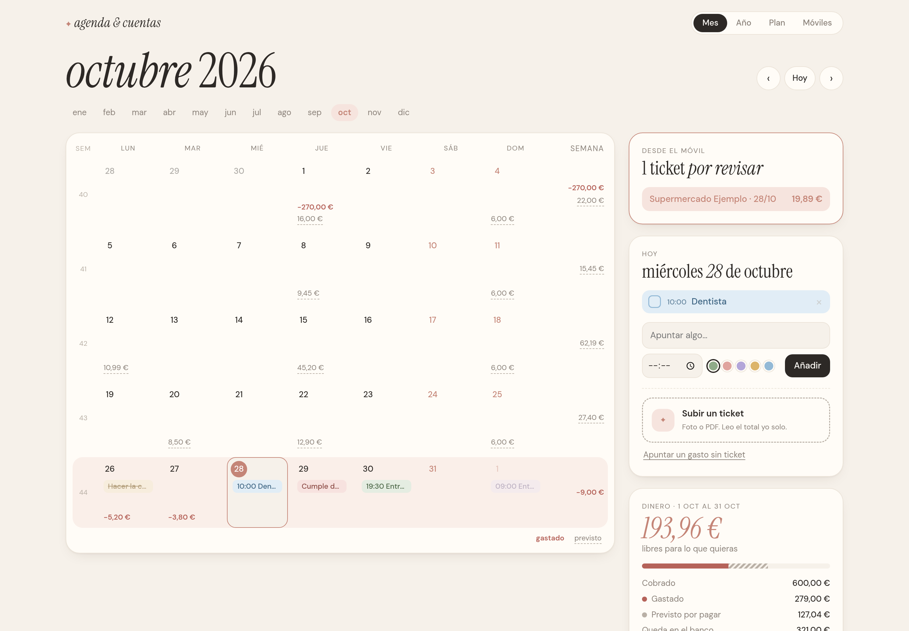
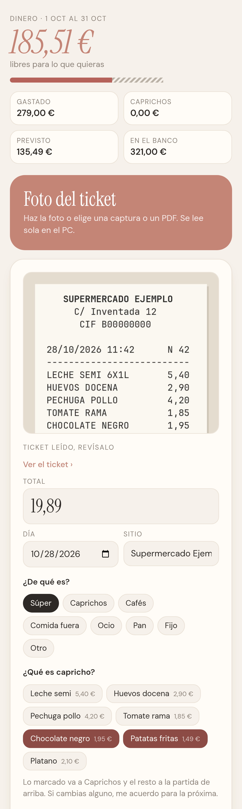

# tickets-presupuesto

Es un presupuesto personal que se rellena solo con las fotos de los tickets.

Me lo hice para llegar a fin de mes sin tener que apuntar cada gasto a mano. Al principio de mes pones lo que cobras y lo que ya sabes que vas a pagar: el alquiler, el gimnasio, los cafés de los sábados, la compra de cada semana. A partir de ahí, cada vez que compras algo haces una foto del ticket con el móvil y el PC de casa se encarga del resto: lo lee, lo apunta en el día que toca y te dice cuánto te queda libre hasta el siguiente cobro.

También separa los caprichos. Si en el ticket del súper van unas patatas fritas y una tableta de chocolate, eso cuenta aparte de la comida, para que veas cuánto se va en eso al mes.

Todo se queda en la wifi de casa. No hay ninguna cuenta ni servidor fuera, los datos de tu dinero no salen de tu PC.





Las capturas son de la demo, con datos inventados.

## Cómo funciona

1. **Haces la foto.** Con la app Android o desde el navegador del móvil, que vale también para iPhone. Puedes mandar una foto, una captura de pantalla como las de Google Wallet o el PDF de un ticket digital.
2. **El PC lo lee.** Con Tesseract saca el total, la fecha, la tienda y cada producto con su precio.
3. **Lo revisas.** El ticket aparece en el calendario como pendiente. Compruebas el total, eliges de qué es y qué productos son capricho. Si corriges alguno, se acuerda para la próxima vez.
4. **Se apunta.** Pasa al calendario como gastado ese día y tacha lo que tenías previsto que pagaba, por ejemplo la compra de esa semana.

Si haces la foto fuera de casa, la app la guarda y la manda sola cuando vuelves a la wifi.

## Lo que hay en la web

- **Calendario:** cada día con lo gastado, lo previsto y tu agenda. Al lado, cuánto llevas gastado y cuánto te queda libre.
- **Plan:** lo que cobras, los gastos fijos, el ocio y la compra por semanas. Al acabar el mes, creas el siguiente copiando el anterior.
- **Móviles:** das de alta cada móvil con un QR y lo puedes quitar cuando quieras.

## Seguridad

Como son datos de dinero, la idea era que nadie más pudiera verlos aunque esté en la misma wifi:

- Los móviles hablan con el PC por https, con un certificado propio del PC.
- Cada móvil tiene su llave, que llega en el QR. El PC solo guarda el hash.
- La app comprueba la huella del certificado antes de mandar nada, así que no le vale cualquier aparato que se haga pasar por el PC.
- Opcional, con ufw: el cortafuegos solo deja entrar a las MAC de los móviles dados de alta.
- Desde la wifi solo se llega a la parte del móvil. El calendario y el plan solo se abren desde el propio PC.

## Por dentro

| Carpeta | Qué es |
|---|---|
| `web/` | Django con SQLite, Tesseract y pdftotext, en Docker |
| `android/` | App en Kotlin con Compose, escáner de documentos de ML Kit y WorkManager para la cola |

## En Windows

No hace falta instalar nada.

1. Baja `TicketsPresupuesto-windows.zip` de la [última versión](https://github.com/JoeyMennon/tickets-presupuesto/releases/latest) y descomprímelo.
2. Doble clic en `Tickets.bat`.
3. Si Windows pregunta por el cortafuegos, pulsa Permitir: es para que entre el móvil.

Se abre el navegador con la web y queda funcionando sin ventanas. Desde entonces arranca solo al encender el PC; `Parar.bat` lo apaga y lo quita del inicio. Tus datos quedan en `%LOCALAPPDATA%\TicketsPresupuesto`, así que para actualizar basta con bajar el zip nuevo.

Sin Docker en Linux o Mac vale lo mismo: `pip install -r web/requirements-sin-docker.txt` y `python web/arrancar.py`, con `tesseract` y `pdftotext` instalados.

## Montarlo con Docker

```bash
cd web
cp .env.example .env    # cambia SECRET_KEY
./despliegue/certificado.sh
docker compose up -d --build
```

La web queda en http://127.0.0.1:8767. Para añadir un móvil, pestaña Móviles, creas un QR y lo escaneas con el móvil en la misma wifi. El navegador se queja del certificado porque es autofirmado, es normal.

Si usas ufw, `sudo despliegue/cortafuegos-movil.sh --nuevo` deja entrar solo a los móviles que des de alta.

Para verlo con datos de mentira: `docker compose -f compose.demo.yaml up -d --build` y abrir http://127.0.0.1:8777

## App

```bash
cd android
./gradlew assembleDebug
```

Se configura leyendo el QR del PC. Si el móvil no tiene servicios de Google, abre la galería en vez del escáner.
